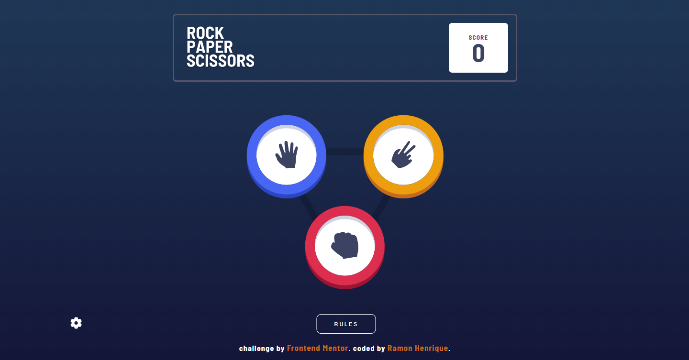
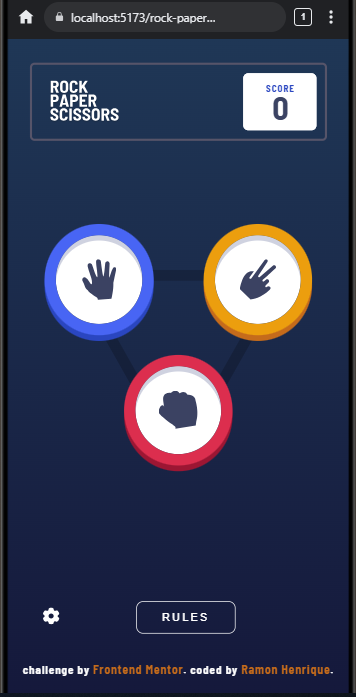

# Rock, Paper, Scissors

Desafio de nível avançado para recriar o famoso jogo de pedra, papel e tesoura o mais próximo do design como possível. Com a possibilidade de adicionar novos movimentos para tornar o jogo mais complexo.




## 🔗 Links

-   Site: [link do deploy](https://RamonDSLOficial.github.io/rock-paper-scissors)
-   Desafio original: [Frontend Mentor](https://www.frontendmentor.io/challenges/rock-paper-scissors-game-pTgwgvgH)

## 🎯 Funcionalidades

-   Ver o layout ideal dependendo do tamanho da tela do dispositivo
-   Ver estados de hover para elementos interativos
-   Adicionar os movimentos extras para aumentar a complexidade
-   Alterar o modo de jogo, para jogar contra o computador e com dois player
-   Persistir a pontuação do jogo
-   Regras do jogo exibindo conforme o modo selecionado

## 🛠️ Tecnologias

-   React
-   TypeScript
-   Styled-components
-   Zustand

## 📚 O que aprendi

-   Trabalhar com a tag `dialog` para diminuir o uso de states e nível de lógica para abrir e fechar o modais
-   Treinar o uso de tags semânticas e atributos aria para melhorar a acessibilidade da aplicação
-   Utilizar o gerenciador de estados Zustand para encapsular lógica e evitar repetição ou prop drilling, deixando de poluir o código

## 🚀 Como rodar o projeto

```bash
git clone https://github.com/RamonDSLOficial/rock-paper-scissors.git
cd seu-repo
npm install
npm run dev
```

## 👤 Autor

-   GitHub - [@RamonDSLOficial](https://github.com/RamonDSLOficial)